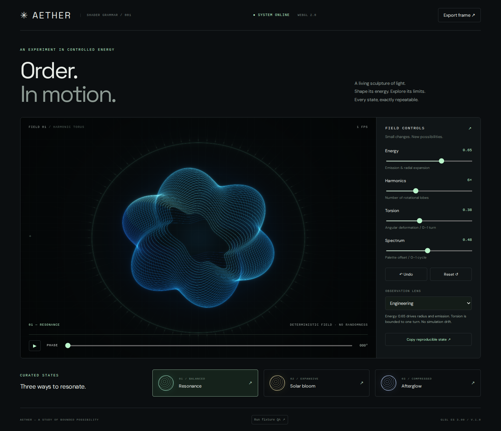
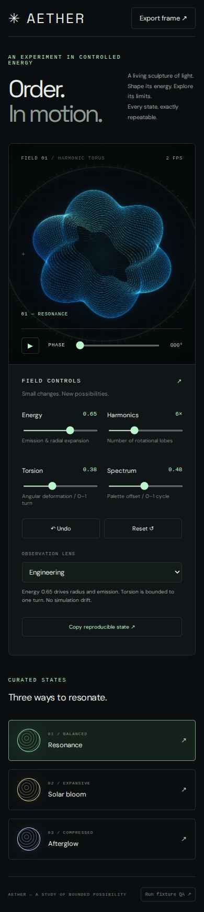
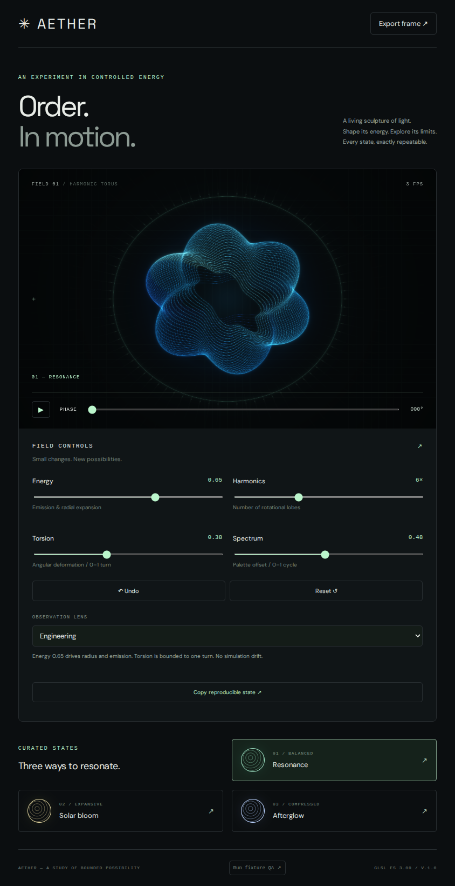

# AETHER v1 verification receipt

**Superseded by the [v2 true-3D verification receipt](v2/README.md).** The current live URL serves v2; the measurements below describe the earlier implementation.

[Live interactive runtime](https://shader-grammar-energetic-observatory.qt-314wink.chatgpt.site) (owner-private Sites hosting).
[Source and method](../../experiments/aether-observatory/README.md).
[CI run](https://github.com/MelodicBloom/shader-grammar/actions/runs/43130932678).

Tested GitHub source commit: `de29dbd`. Deployed Sites source commit: `f0e5abc2fa634036c3cca4912180e5f196622972`. The `dist/` files are byte-identical in these source states. Sites reports successful deployment. Separate repository roots are used because the Sites service owns its source mirror; GitHub remains the reviewable project source.

## Measured challenge

18/19 assertions pass. All 18 functional assertions pass; the performance target fails on CI's software renderer.

| Challenge | Result |
|---|---|
| GLSL ES 3.00 program compile/link | Pass |
| Fixture redraws | All 3 pass; 0 differing bytes each |
| Visible structure | 191,560 / 150,163 / 217,900 color channels above 30 |
| Bounds, energy response, healthy WebGL context | Pass |
| Preset label and exact undo | Pass |
| Keyboard and reset | Pass |
| Overflow at 390px and 844px | None |
| Fragment replay | Exact paused phase restored |
| Browser exceptions | 0 |
| 30 FPS / 33.34ms target | FAIL: 344.11ms/render including readback at 1023×692 |

Full machine-readable evidence: [qa.json](qa.json). Browser: Playwright Chromium with SwiftShader, Ubuntu 24.04 GitHub runner. These are device-specific measurements. Software timing is not a physical GPU measurement; physical GPU 30 FPS remains unverified. CI succeeds when functional assertions pass and reports performance separately. This is an adversarial acceptance Q&A, not an empirical competitor comparison or user satisfaction study.

## Visual inspection

Desktop and portrait screenshots were inspected. The final pass corrected unused canvas space, weak filament contrast, and a stale preset label after undo. Landscape layout also has no horizontal overflow.

## Reproduce

Serve `experiments/aether-observatory/dist/` to explore the standalone build. Pause to inspect an exact phase. Use the in-app **Run fixture QA** button for device-specific rendering checks. Automated tests and bounds are documented with the example. Same-device deterministic redraw is verified; cross-GPU floating-point equivalence is not promised.

## Research and implementation scope

The [example README](../../experiments/aether-observatory/README.md) contains the definition of done/failure, bounded controls, mathematical fixtures, method → action → outcome explanations, Behance/Awwwards/Superdesign reference links, and limitations. The sculpture is an analytic artistic field; it does not claim physical energy conservation or implement the repository's optical ontology.
