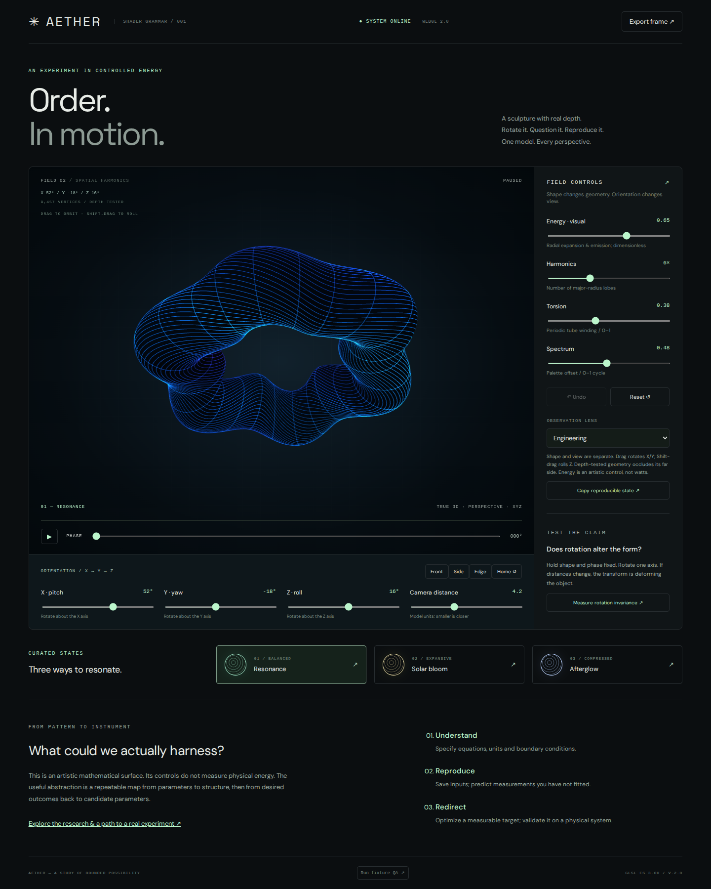
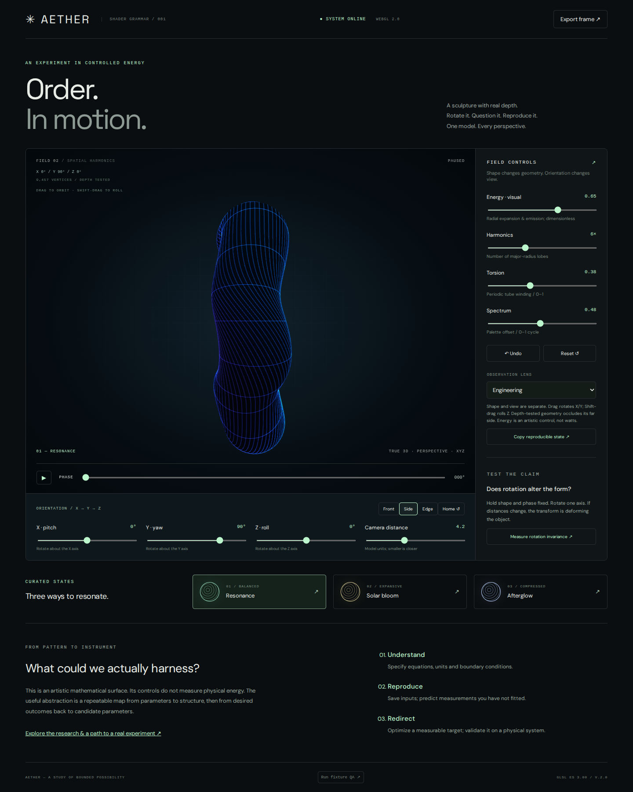
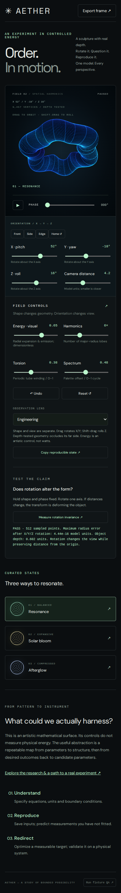
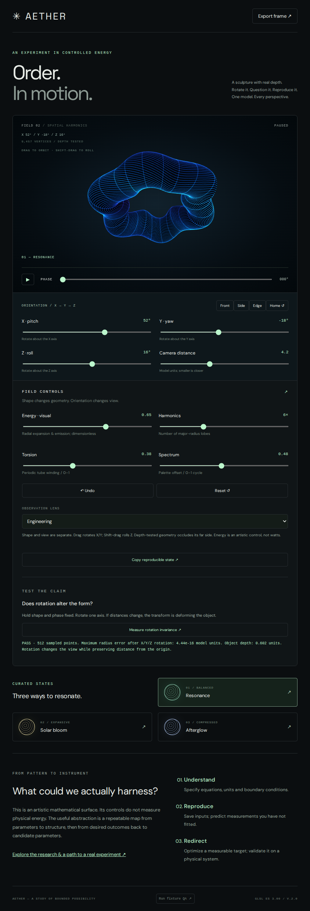

# AETHER v2 — 3D verification receipt

[Live observatory](https://shader-grammar-energetic-observatory.qt-314wink.chatgpt.site) · [Applications and physical experiment plan](https://shader-grammar-energetic-observatory.qt-314wink.chatgpt.site/applications.html) · [Source and equations](../../../experiments/aether-observatory/README.md) · [CI run](https://github.com/MelodicBloom/shader-grammar/actions/runs/43479876879).

Tested application source: GitHub `1a2c3ca`. Sites source: `76017d896c67de79b27b698da86d6a1b0838472d`. All files in the two `dist/` trees were checked byte-identical. The subsequent README rewrite changes documentation only.

## Results

**41/42 assertions passed: all 41 functional assertions pass.** The one failed assertion is the under-33.34ms completed-render target. CI treats performance separately, reports the failure, and succeeds only when functional assertions pass. Hardware-GPU performance is unverified.

| Test | Measured result |
|---|---|
| GLSL ES 3.00 shader compile/link | Pass |
| All three same-device fixture redraws | 0 differing bytes each |
| Independent X/Y/Z view changes | Pass, each axis changes rendered pixels |
| Full-turn canonical equivalence | Exact original pixels |
| Return after an intervening rotation | Exact original pixels |
| Nonzero 3D model depth | 0.6024344918 model units |
| Rigid rotation, 512 sampled points | Maximum radius error 4.4408920985e-16 model units |
| Mathematical pairwise-distance and periodic-seam tests | Pass |
| Pose-only views, XYZ keyboard sliders, canvas keys | Pass |
| X/Y drag, Z roll, one-action gesture undo | Pass |
| Camera/phase/shape URL replay in a fresh page | Exact state restored, paused |
| Replay in an already-open tab, unknown version handling | Pass |
| Reset, reduced motion, PNG export | Pass |
| Paused GPU redraw cessation | Pass |
| 390px portrait and 844px landscape | No horizontal overflow |
| Browser exceptions | 0 |
| Completed render + pixel readback, 1023×783 | **74.97ms/frame — misses 30 FPS target** |

[Full machine-readable results](qa.json). Browser: Playwright Chromium with SwiftShader, Ubuntu 24.04 CI runner. Results are specific to that software renderer and viewport; they are not a physical-GPU benchmark. This is a falsifiable acceptance challenge, not a head-to-head competitor or human satisfaction study.

## What changed and why

The former implementation constructed apparent depth in a fragment shader. V2 evaluates a parametric 3D surface in a GLSL vertex shader, renders depth-tested triangles, then renders luminous contour lines and points on the surface. Its rigid transform is `Rz * Ry * Rx`, independent of shape deformation. A perspective camera exposes thickness, occlusion and changes of viewpoint. Explicit camera controls, drag/roll gestures and versioned state replay make the view reversible and reproducible.

The inquiry asks whether rotation changes shape. The on-page experiment measures a quantity that should stay invariant. The reverse-engineering explanation states which observations can determine which controls, and why one silhouette cannot uniquely identify arbitrary 3D structure. It does not claim a general image inversion or physics solver.

The applications essay separates this dimensionless artistic surface from established acoustic and photonic work. It proposes calibration, a measured forward map, constrained inverse control, held-out measurements and power accounting as the bridge to physical use. No real-world energy or force effect is claimed by the graphics.

## Reviewed screenshots

Desktop, side, portrait and landscape screenshots were inspected. The side view demonstrates actual model depth; the portrait view retains all axis controls and replay controls.

